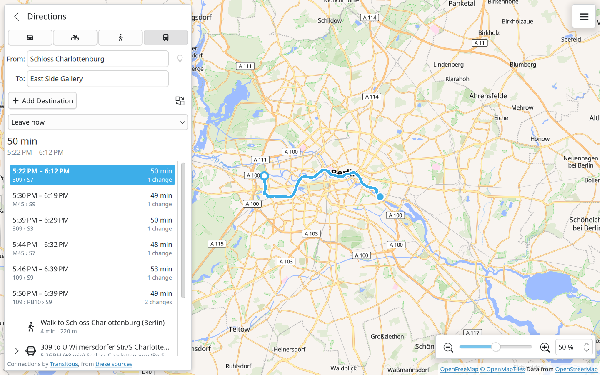

<!--
SPDX-FileCopyrightText: 2026 Karten contributors
SPDX-License-Identifier: CC0-1.0
-->

<p align="center">
  
</p>

# Karten

A simple map for the Plasma desktop: search for a place and plan a route there
by car, by bicycle, on foot or by public transport. The map, routing and place
search keep working without an internet connection for the areas you have
downloaded; public transport needs a connection.



Map data © [OpenStreetMap](https://www.openstreetmap.org/copyright) contributors;
the map is provided by [OpenFreeMap](https://openfreemap.org) and drawn by
[MapLibre](https://maplibre.org).

## Installing

```sh
flatpak install --user https://n4n0gh.github.io/Karten/karten.flatpakref
```

or open <https://n4n0gh.github.io/Karten/> and choose *Install Karten*.
Installed this way, Karten is updated together with your other applications.
Each [release](https://github.com/n4n0GH/Karten/releases) also carries
`karten.flatpak` as a single file to download; it updates from the same place.

## Building

Needs Qt 6.6+ (Quick, Positioning, Location, Sql, Network, Concurrent), KDE
Frameworks 6.8+ (ECM, Kirigami, KI18n, KCoreAddons, KConfig, KColorScheme,
KWallet),
KOpeningHours, KPublicTransport,
zlib and
[MapLibre Native Qt](https://github.com/maplibre/maplibre-native-qt) 3.0 with
its Qt Location plugin.

Few distributions package MapLibre Native Qt. `scripts/build-maplibre.sh`
builds it into a directory next to the source tree; it needs the Qt Location
private headers (openSUSE: `qt6-location-private-devel`).

```sh
scripts/build-maplibre.sh ../Karten-deps/prefix    # once
cmake -B build -G Ninja -DCMAKE_PREFIX_PATH=$PWD/../Karten-deps/prefix
cmake --build build
ctest --test-dir build
./build/bin/karten
```

A Flatpak can be built with
`flatpak-builder --user --install --force-clean build-flatpak flatpak/io.github.n4n0gh.karten.yml`.

The map needs OpenGL; Karten selects it and Qt's single-threaded render loop
itself, as the MapLibre plugin asks for.

## How it works

The table below is the short version; [docs/](docs/README.md) describes the
code in detail.

| Part | Where | Notes |
| --- | --- | --- |
| Routing core | `src/core` | OSM PBF reader, road graph, A* router, turn instructions. No GUI dependencies; covered by `autotests/routertest.cpp`. |
| Map | `src/tilestore.*`, `src/tileserver.*` | The map view (MapLibre) only talks to a server inside the application. It hands out the map style with every address pointing back at itself, answers from an SQLite store, and fetches from the configured map source when needed. That is what makes the map work offline. |
| Offline data | `src/offlinemanager.*`, `src/extractimporter.*` | Downloads a [Geofabrik](https://download.geofabrik.de/) extract and turns it into a road graph and a place-name database; downloads the map of an area where the map source permits. |
| Search | `src/geocoder.*` | Downloaded regions while typing; Nominatim when a query is submitted. |
| Places on the map | `src/core/vectortile.*`, `Geocoder::placeAt`, `Geocoder::lookUpDetails` | A click is matched against the points of interest in the stored vector tile under it, so it works offline. Address, opening hours and the like come from the downloaded region the place lies in, or else from Nominatim; a linked Wikipedia article adds a summary and a picture. |
| Routes | `src/routecontroller.*` | Downloaded data when it covers both ends, otherwise the FOSSGIS OSRM server. |
| Interface | `src/qml` | Kirigami. |

`karten-route` is a developer tool that builds a graph from a `.osm.pbf` file
and prints a route:

```sh
./build/bin/karten-route berlin.osm.pbf 52.5163,13.3777 52.5200,13.4050 bike
```

## Online services and their rules

Karten uses free community services. Their usage policies shape the design:

- **OpenFreeMap** (default map, vector tiles): its
  [terms](https://openfreemap.org/tos/) permit offline downloads of at most
  3,000 tiles or 50 MB each, with at most 4 parallel requests and an
  identifying User-Agent. Karten enforces both limits per download (an area of
  roughly 70 km across at full detail) and uses 2 parallel requests.
- The map choice *Automatic* shows OpenFreeMap's standard map with light
  colours and its dark map with dark colours. Both draw from the same vector
  tiles, which are stored once; an offline download also fetches the icons,
  fonts and relief images of the other one, so it works with either.
- **Other map sources** (chosen in *Settings*): any MapLibre style, or image
  tiles given as an address with `{z}`, `{x}` and `{y}`.
  tile.openstreetmap.org can be viewed but not downloaded: its
  [policy](https://operations.osmfoundation.org/policies/tiles/) forbids that.
- Whatever the source, the parts of the map you have looked at are kept and
  stay visible offline.
- **Nominatim** (search, place details): no search-as-you-type and at most one
  request per second, so online search only runs when a query is submitted,
  and details are asked for only when a place is clicked.
- **Wikipedia and Wikidata** (place summaries and pictures): asked only when
  a clicked place links to an article, with an identifying User-Agent, also
  for the picture. The text is credited to Wikipedia under CC BY-SA and the
  picture links to its page, which names author and licence.
- **Google** (optional ratings and reviews): off unless the user ticks a box
  in the settings and enters their own key for the Places API. Google's
  [terms](https://cloud.google.com/maps-platform/terms) (section 3.2.3 e) do not
  permit showing Places content on or near a map that is not Google's, which
  the settings page says before the box can be ticked. Requests go out only
  when a named place is clicked, and nothing that comes back is stored. The
  key is kept in the wallet (KWallet), which is only opened once the box is
  ticked. The
  "Google Maps" button in the place panel is separate: it only opens the web
  browser.
- **routing.openstreetmap.de** (online routes): at most one request per second.
- **Transitous** (public transport connections, through KPublicTransport): a
  community-run service for free software that is open source, not
  commercial and light on its resources; see its
  [usage policy](https://transitous.org/api/). Requests carry the User-Agent
  with the project's address, the directions panel links to
  <https://transitous.org/sources/>, and a request is only made when the
  start, the destination or the time of a public transport route changes.
  The policy asks for coordination above about 720 route requests a day
  across all users, which matters once Karten has many.
- **Geofabrik** (offline routing data): regional OpenStreetMap extracts.

The service addresses can be changed in `~/.config/kartenrc` (`[Map] Source`,
`[Services] NominatimUrl`, `[Services] RoutingUrl`).

To see what the map server inside Karten is asked for, run it with
`QT_LOGGING_RULES="karten.tileserver.debug=true"`.

## Known limitations

- Public transport is online only, goes from the start to the destination
  without the stops in between, and cannot be bent by dragging. Only
  Transitous is asked, although KPublicTransport knows many operators' own
  services: each of those has terms of its own.

- Place details are kept for points and simple outlines; places mapped as
  relations (some large buildings and sites) get theirs online only. Regions
  downloaded before details were kept need to be updated to have them.

- A downloaded map area holds the fonts for Latin, Greek and Cyrillic script;
  labels in other scripts appear offline only where they were looked at before.
- The map loads while its window is being drawn, so nothing is fetched while
  the window is hidden.

- The offline router ignores turn restrictions, barriers and live traffic, and
  snaps start and destination to the nearest road node.
- A route is planned offline only when one downloaded region covers the start,
  the destination and all stops on the way. A route has at most ten places.
- Dragging the route on the map adds a place it passes; the route is planned
  anew through it, so the result can differ from the line that was dragged.
  Such detours are dropped when the stops around them change.
- Extracts larger than 1 GiB are not offered: building the routing data needs
  roughly twice the extract size in memory.
- Offline search finds streets, towns and points of interest by name, not
  house numbers.

## Licence

GPL-3.0-or-later, see `LICENSES/`.
